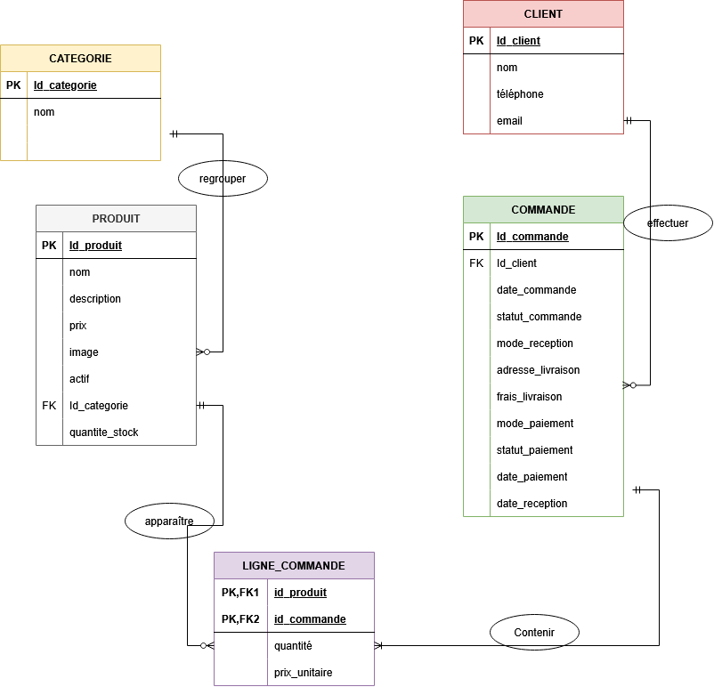
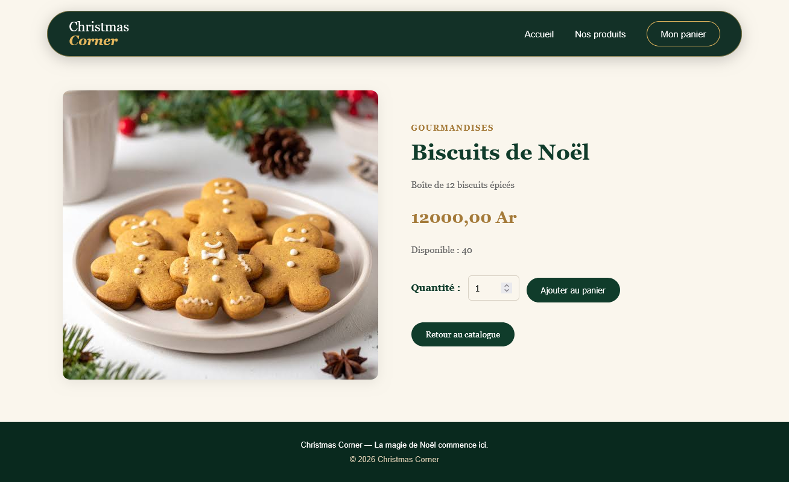
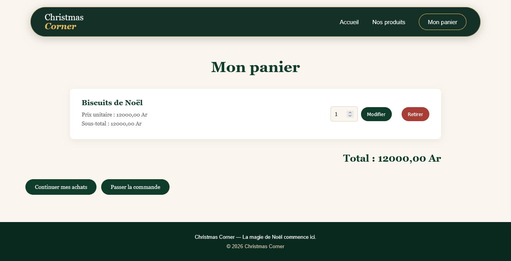
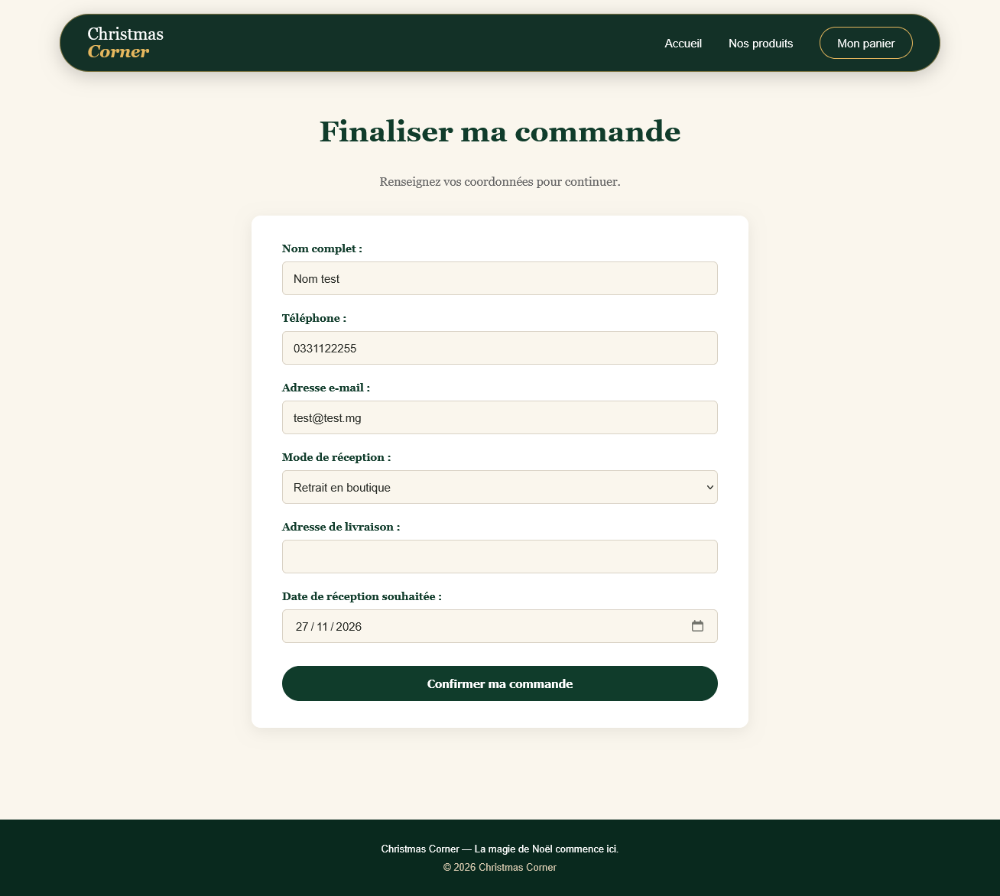
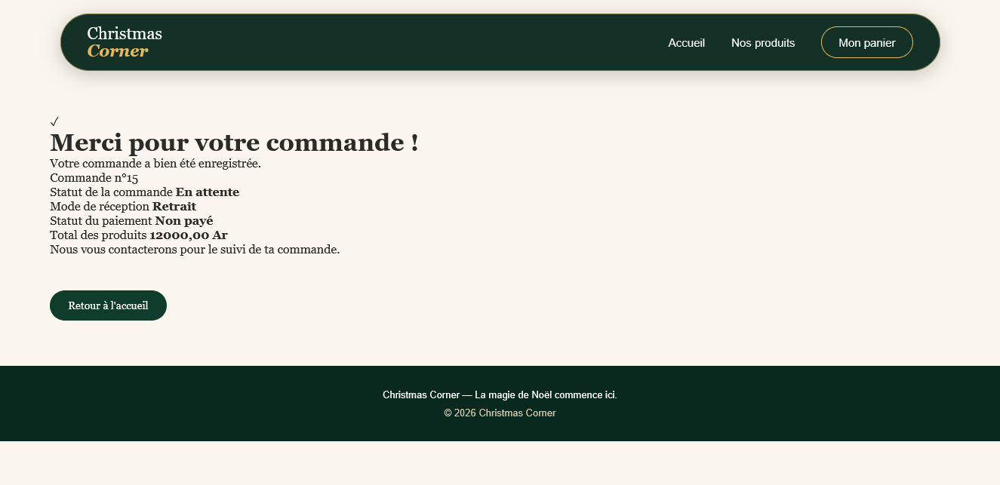
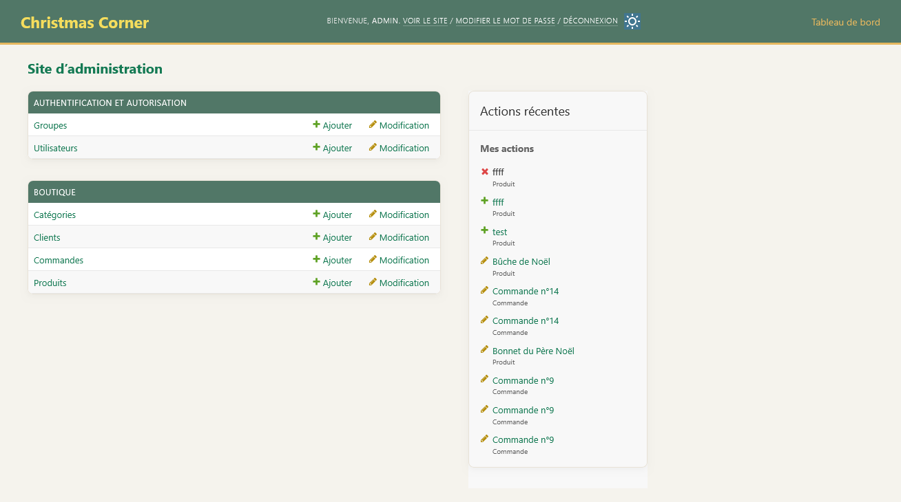
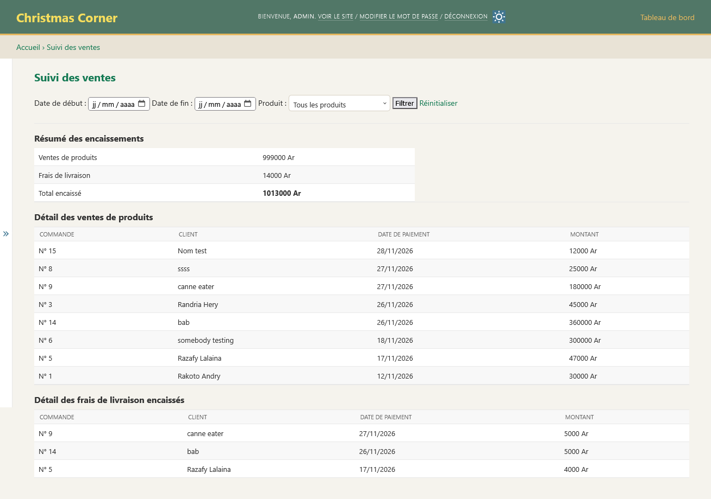
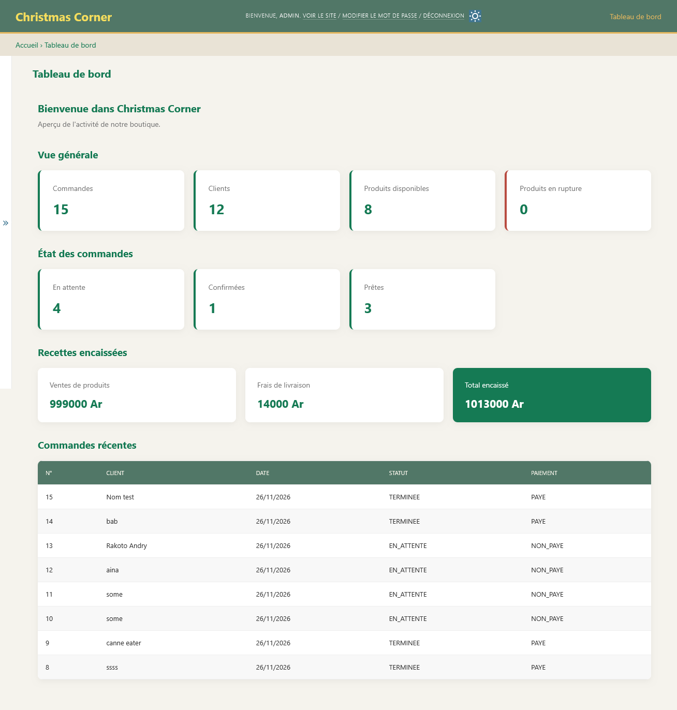
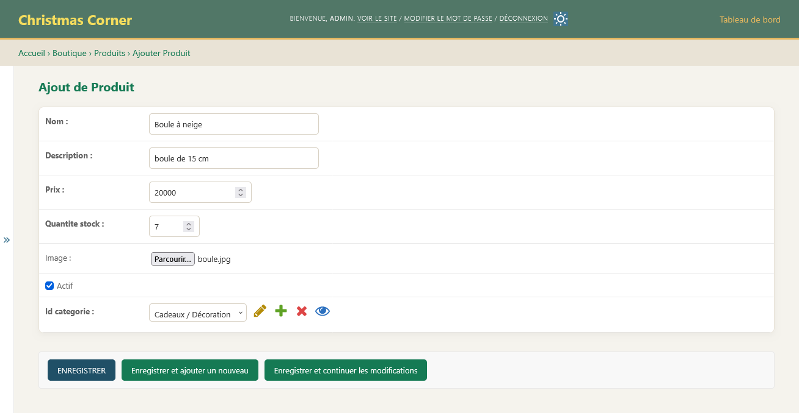

# Christmas Corner

## 1. Présentation du projet

Christmas Corner est une application web de gestion et de vente de produits de Noël.

Elle permet aux clients de consulter un catalogue, de constituer un panier et de passer une commande avec un choix entre le retrait en boutique et la livraison.

Un espace administrateur permet de gérer les produits, les catégories, les clients, les commandes, les stocks et le suivi des ventes.

### Objectifs

- Faciliter la consultation et l'achat des produits de Noël.
- Simplifier la gestion des commandes.
- Assurer le suivi des stocks.
- Centraliser les informations relatives aux clients et aux ventes.

## 2. Technologies utilisées

- Python
- Django
- PostgreSQL
- HTML
- CSS
- Git et GitHub

## 3. Fonctionnalités

### Espace client

- Consultation du catalogue.
- Filtrage des produits par catégorie.
- Consultation des détails des produits.
- Ajout de produits au panier.
- Modification des quantités et suppression des articles.
- Consultation du montant total.
- Passage de commande sans création de compte.
- Choix entre le retrait en boutique et la livraison.
- Affichage d'une confirmation de commande.

### Espace administrateur

- Gestion des catégories et des produits.
- Modification des prix et des stocks.
- Activation et désactivation des produits.
- Consultation des informations des clients.
- Gestion des commandes et de leurs statuts.
- Enregistrement des paiements.
- Définition des frais de livraison.
- Suivi des ventes.
- Communication avec les clients par WhatsApp et par e-mail.

## 4. Fonctionnement de l'application

### 4.1. Côté client

1. Le client accède à la page d'accueil.
2. Il consulte le catalogue et peut filtrer les produits par catégorie.
3. Il sélectionne un produit et indique la quantité souhaitée.
4. Il ajoute le produit à son panier.
5. Il peut modifier les quantités ou supprimer des articles.
6. Il valide son panier et renseigne ses coordonnées.
7. Il choisit le mode de réception :
   - **Retrait :** récupération de la commande en boutique.
   - **Livraison :** renseignement obligatoire de l'adresse de livraison.
8. Il valide sa commande.
9. L'application vérifie la disponibilité des produits et enregistre la commande si le stock est suffisant.
10. Une page de confirmation présente le récapitulatif de la commande.

Le panier est conservé dans la session du navigateur. Le client n'a pas besoin de créer un compte.

### 4.2. Côté administrateur

L'administrateur se connecte à l'interface Django avec son compte autorisé.

Il peut consulter les commandes enregistrées et faire évoluer leur statut :

| Statut | Signification |
|---|---|
| EN_ATTENTE | Commande enregistrée, en attente de traitement |
| CONFIRMEE | Commande validée |
| PRETE | Commande préparée et prête à être remise |
| TERMINEE | Commande remise au client et payée |
| ANNULEE | Commande annulée |

L'administrateur détermine les frais de livraison, contacte le client quand la commande est prête et enregistre le paiement.

### 4.3. Gestion du stock

Lorsqu'une commande est passée, l'application vérifie que les quantités demandées sont disponibles.

Le stock n'est pas déduit immédiatement à la création de la commande. La déduction intervient lorsque l'administrateur fait passer la commande au statut TERMINEE.


### 4.4. Gestion des paiements

Le paiement s'effectue intégralement au moment du retrait ou de la livraison.

Les modes de paiement disponibles sont :
- Espèces ;
- Mobile Money.

L'administrateur enregistre le statut, le mode et la date du paiement.


### 4.5. Livraison et communication

Les frais de livraison sont déterminés et renseignés manuellement par l'administrateur. Ils sont communiqués ultérieurement au client par whatsapp ou par e-mail.

L'application permet :
- D'ouvrir WhatsApp avec un message prérempli pour contacter le client.
- De préparer des e-mails concernant la commande ou les frais de livraison.

**Remarque :** dans ce projet, les e-mails utilisent le mode console de Django. Leur contenu est affiché dans le terminal du serveur et n'est pas envoyé automatiquement à une adresse e-mail.

## 5. Base de données

La base de données PostgreSQL comporte cinq tables principales :

| Table | Description |
|---|---|
| `categorie` | Enregistre les catégories de produits. |
| `produit` | Contient les informations des produits et leur stock. |
| `client` | Enregistre les coordonnées des clients. |
| `commande` | Contient les informations générales des commandes. |
| `ligne_commande` | Détaille les produits et les quantités de chaque commande. |

### 5.1. Modèle entité-association

Le modèle entité-association présente les entités principales de l'application et les relations entre elles.



### 5.2. Conception


Les scripts SQL de création et d'initialisation sont disponibles dans le dossier `sql/` :
- `schema.sql` : création des tables, contraintes et index.
- `data.sql` : insertion des données de démonstration.

## 6. Installation et configuration

### 6.1. Prérequis

Avant l'installation, il faut disposer de :
- Python ;
- PostgreSQL ;
- Git ;
- pip.

### 6.2. Cloner le dépôt

```bash
git clone URL_DU_DEPOT
```

Accéder au dossier du projet :

```bash
cd christmas_corner
```

### 6.3. Créer un environnement virtuel

```bash
python -m venv .venv
```

Sous Git Bash, activer l'environnement :

```bash
source .venv/Scripts/activate
```

### 6.4. Installer les dépendances

```bash
pip install -r requirements.txt
```

### 6.5. Créer et initialiser la base de données

Créer une base de données PostgreSQL portant le nom choisi pour le projet.

Exemple :

```sql
CREATE DATABASE christmas_corner;
```

Exécuter ensuite les scripts SQL depuis le dossier du projet :

```bash
psql -U postgres -d christmas_corner -f sql/schema.sql
```

Puis :

```bash
psql -U postgres -d christmas_corner -f sql/data.sql
```

Remplacer `christmas_corner` par le nom réel de la base si un autre nom a été choisi.

### 6.6. Configurer les variables d'environnement

Chaque utilisateur doit définir ses propres variables d'environnement avant de lancer Django.

Sous Git Bash :

Générer une nouvelle clé secrète Django :

```bash
export DJANGO_SECRET_KEY="$(python -c 'from django.core.management.utils import get_random_secret_key; print(get_random_secret_key())')"
```

Définir le mot de passe PostgreSQL :

```bash
export DB_PASSWORD="votre_mot_de_passe_postgresql"
```

Ces variables doivent être définies dans le terminal utilisé pour lancer le serveur. Elles doivent être redéfinies dans un nouveau terminal.

### 6.7. Configurer la connexion PostgreSQL

Dans `config/settings.py`, vérifier les paramètres de connexion à la base de données.

Le nom de la base, l'utilisateur et le port doivent correspondre à la configuration PostgreSQL de l'utilisateur.

Exemple :

```python
DATABASES = {
    'default': {
        'ENGINE': 'django.db.backends.postgresql',
        'NAME': 'christmas_corner',
        'USER': 'postgres',
        'PASSWORD': os.environ.get('DB_PASSWORD', ''),
        'HOST': 'localhost',
        'PORT': '5432',
    }
}
```

La clé secrète doit également être récupérée depuis la variable d'environnement `DJANGO_SECRET_KEY`.

### 6.8. Créer les tables internes de Django

Exécuter :

```bash
python manage.py migrate
```

Cette commande crée les tables nécessaires au fonctionnement interne de Django, notamment celles liées aux sessions et à l'authentification.

Elle ne remplace pas les scripts SQL de création des cinq tables métier.

### 6.9. Créer un compte administrateur

Exécuter :

```bash
python manage.py createsuperuser
```

Entrer le nom d'utilisateur, l'adresse e-mail et le mot de passe demandés.

Chaque personne qui installe le projet doit créer son propre compte administrateur. Les identifiants ne sont pas fournis dans le dépôt GitHub.

## 7. Lancement de l'application

Une fois l'installation et la configuration terminées, lancer le serveur :

```bash
python manage.py runserver
```

L'application est accessible depuis un navigateur.

- **Site client :** http://127.0.0.1:8000/
- **Administration :** http://127.0.0.1:8000/admin/

Pour accéder à l'administration, utiliser les identifiants du superutilisateur créé précédemment.

## 8. Captures d'écran

Les captures suivantes illustrent les principales fonctionnalités de l'application.

### Partie client

**Page d'accueil**


**Catalogue des produits**


**Détail produit**


**Panier**



**Passage de commande**



**Confirmation de commande**



### Partie administrateur

**Interface d'administration**



**Suivi des ventes**



**Tableau de bord**



**Ajout produit**




## 9. Tests et démonstration

Pour reproduire une démonstration complète, suivre les étapes ci-dessous.

### 9.1. Tester la partie client

1. Ouvrir le site client.
2. Accéder au catalogue.
3. Filtrer les produits par catégorie.
4. Consulter les détails d'un produit.
5. Ajouter un produit au panier.
6. Modifier sa quantité et vérifier le montant total.
7. Ajouter éventuellement un autre produit.
8. Valider le panier.
9. Renseigner les coordonnées du client.
10. Choisir le retrait ou la livraison.
11. Valider la commande.
12. Vérifier l'affichage de la confirmation.

### 9.2. Tester la partie administrateur

1. Accéder à `/admin/`.
2. Se connecter avec le compte administrateur.
3. Consulter la commande créée précédemment.
4. Modifier son statut en CONFIRMEE.
5. La faire passer à PRETE.
6. Vérifier les possibilités de contact par WhatsApp et par e-mail.
7. Pour une livraison, renseigner les frais et vérifier le message destiné au client.
8. Enregistrer le paiement en indiquant son mode et sa date.
9. Faire passer la commande à TERMINEE.
10. Vérifier que les quantités correspondantes ont été déduites du stock.
11. Consulter la page de suivi des ventes.


## 10. Arborescence du projet

```text
christmas_corner/
│
├── boutique/          # Application Django
├── config/            # Configuration du projet
├── docs/              # Schémas et captures d'écran
├── media/             # Images des produits
├── sql/               # Scripts SQL
├── static/            # Fichiers CSS et images statiques
├── templates/         # Templates HTML
│
├── manage.py
├── requirements.txt
├── README.md
└── .gitignore
```

## 11. Limites de l'application

La version actuelle de Christmas Corner est destinée à la démonstration et à la gestion locale des commandes.

Elle ne comprend pas :
- La création de comptes clients.
- Le paiement en ligne.
- L'envoi automatique des e-mails via un serveur SMTP.
- Le calcul automatique des frais de livraison.
- La réservation du stock au moment de la création de la commande.
- Le suivi géographique des livraisons.

